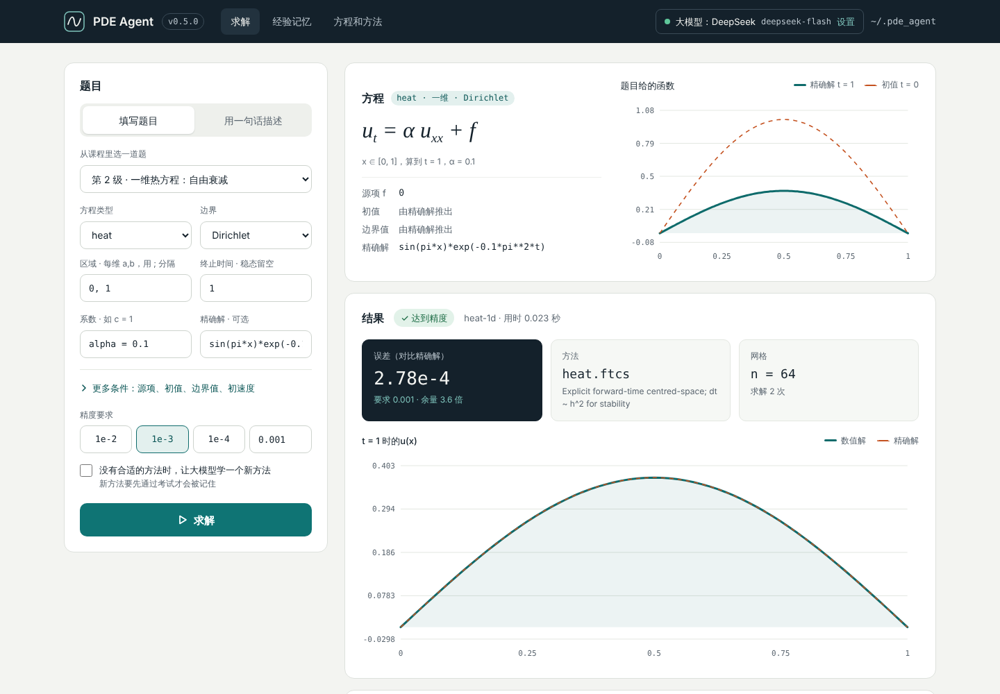

# pde-agent：会学习进化的偏微分方程求解 agent

从最基础的方程开始，agent 自己选方法、自己验证结果、记住每次的经验；遇到不会的方程时请大模型（Claude 或 DeepSeek）写新的求解器，新求解器考试通过才收进技能库。

## 现在会解什么

| 方程 | 形式（`L(u) = f`） | 内置方法（收敛阶） |
| --- | --- | --- |
| Poisson（1D、2D，Dirichlet 边界） | `-k Δu = f` | `poisson.fd2` 中心差分 + 稀疏直接解（2） |
| 热方程（1D，Dirichlet） | `u_t = α u_xx + f` | `heat.ftcs` 显式（2）、`heat.backward_euler`（1）、`heat.crank_nicolson`（2） |
| 对流方程（1D，周期边界） | `u_t + c u_x = f` | `advection.upwind`（1）、`advection.lax_wendroff`（2） |
| 波动方程（1D，Dirichlet） | `u_tt = c² u_xx + f` | `wave.leapfrog`（2） |

所有内置方法都用制造解（method of manufactured solutions）测过，实测收敛阶和标称一致。

## agent 怎么学习进化

1. **自我验证**：有精确解就直接算误差；没有精确解时，用两套嵌套网格的差做 Richardson 估计，并在观测收敛阶低于标称阶时改用观测值（偏保守）。测试里拿更细网格的解做参照，确认真实误差不超过容差的 2 倍。
2. **经验记忆**：每次求解都写进 `~/.pde_agent/experience.jsonl`，按问题类别（如 `heat/1d/dirichlet`）统计每个方法的成功率和计算量。
   - 选方法：没试过的方法先试一次（探索），之后优先用成功率高、计算量小的（利用）。
   - 选网格：根据以前在多大网格上达到多高精度，直接预测这次需要的网格，不用每次从粗网格加密上去。
3. **技能库**：没有方法能解的问题（新方程、新维度），或者现有方法都达不到精度时，agent 请大模型写一个新的求解器模块。新模块要过两关才能入库：
   - 静态检查：只允许 numpy、scipy、sympy、math 和 `pde_agent.skill_api`，不能读写文件、开进程、用 `eval` 等；
   - 独立进程里的考试：在 16、32、64 网格上解几个已知答案的制造解问题，误差要足够小，收敛阶要达到声明的阶。

   没通过就把考试报告发回给大模型修改，最多 3 轮。入库的技能下次启动自动加载。
4. **课程表**：从一维 Poisson 开始，依次是热方程、对流、波动、二维 Poisson，再到没有精确解、要自己估计误差的问题。最后是“前沿课程”：反应扩散方程、二维热方程、非线性 Burgers 方程，这些没有内置方法，要 agent 自己学。

不接大模型，把课程表跑两轮的结果：

```
第 1 轮：成功 12/12，共求解 26 次，工作量 1.23e+07
第 2 轮：成功 12/12，共求解 14 次，工作量 4.77e+04
```

第一轮在探索，比如对流方程试了一阶迎风格式，要 4096 个网格才达到精度。第二轮根据经验改用 Lax–Wendroff 和 Crank–Nicolson，网格大小直接预测，求解次数少了将近一半，计算量少了两个多数量级。

## 快速开始

```bash
pip install -e ".[dev]"            # 只用内置方法
pip install -e ".[dev,llm]"        # 加上 Claude（需要 ANTHROPIC_API_KEY）
pip install -e ".[dev,deepseek]"   # 加上 DeepSeek（需要 DEEPSEEK_API_KEY）

pde-agent app                      # 打开网页版（见下面“网页版”）
pde-agent curriculum --rounds 2    # 从基础方程开始练习
pde-agent stats                    # 看学到的经验
pde-agent bench                    # 在基准题上给各个方法和 agent 的选择打分
pde-agent skills                   # 看已知的方程和方法
pde-agent solve examples/heat_rod.json --tol 1e-4

# 下面这些需要大模型（见“接入大模型”）
pde-agent ask "在 [0,1] 上解 u_t = 0.01 u_xx，初值 sin(pi x)，两端为 0，算到 t = 1"
pde-agent curriculum --frontier --learn   # 让 agent 自己学会反应扩散、二维热方程、Burgers
```

## 网页版

```bash
pde-agent app        # 打开 http://127.0.0.1:8765/
```

在浏览器里选一道课程题或自己填写题目，点“求解”就能看到解的图像、误差和 agent 试过的方法；也可以切到“用文字描述”，让大模型理解题目后再解（需要先设置好大模型，见“接入大模型”）。页面中间的“数学问答”可以问偏微分方程求解以外的数学问题（用设置好的大模型回答，对话保存在浏览器里）。右边会先画出题目给的函数（精确解、初值或源项），改题目时跟着变。页面下方是经验记忆和已知方法。网页只在本机能打开，按 Ctrl+C 退出。

**在网页里选大模型、填 API key**：点右上角的“大模型”按钮，选 Claude 或 DeepSeek 和模型，粘贴 API key，点“保存”。以后每次打开网页（命令行也一样）都会自动用这里保存的选择和 key，不用再设置环境变量。key 保存在本机的 `~/.pde_agent/settings.json`（跟随 `--home` / `PDE_AGENT_HOME`），只有你的账户能读，页面上只显示开头和结尾几位；在同一个窗口里可以删除。



## 基准评测

`pde-agent bench` 在 7 道有精确解的基准题上给方法打分，用来比较求解方法、检查 agent 选得好不好：

| 基准题 | 考什么 |
| --- | --- |
| `heat-decay` | 热方程，单个模态指数衰减 |
| `heat-stiff` | 热方程，高频模态瞬间衰减（刚性）：Crank–Nicolson 在粗网格上振荡，误差很大 |
| `advection-smooth` | 对流，光滑波平移一个周期 |
| `advection-long` | 对流，传播 5 个周期，考验数值耗散和色散 |
| `wave-two-modes` | 波动方程，两个驻波模态叠加 |
| `poisson-2d` | 二维 Poisson |
| `burgers-cole-hopf` | 黏性 Burgers 方程，Cole–Hopf 精确解；没有内置方法，学会的技能可以在这里比 |

每个能解这道题的方法从粗网格开始逐次加密，直到误差达到精度要求（默认 1e-3）。**方法的得分是达到精度那次求解的耗时**（重复 3 次取最快），也就是“如果事先知道该用多大网格”时的代价，最快的标 ★。然后用一个没有任何经验的 agent 解同一道题（不读也不写经验记忆，会加载学会的技能），看它最后用了哪个方法、整个过程（包括试错）花了最快方法的几倍时间。

```bash
pde-agent bench                                  # 全部基准题
pde-agent bench --problem heat-stiff --tol 1e-4  # 只跑一道题，换个精度
pde-agent bench --no-agent --json bench.json     # 只给方法打分，详细结果存成 JSON
```

耗时是墙钟时间，换台机器会变，但同一台机器上方法之间的比较是可靠的。

## 多人共享经验

几个人可以共用一个“经验中心”：每个人的 agent 解完题都会把记录传上去，同时下载别人的记录。这样大家挑方法、猜网格大小用的是所有人的经验。

**1. 管理员：在一台大家都能访问的服务器上运行经验中心**（需要 Python 3.10+，不用装大模型 SDK）

```bash
pip install "pde-agent @ git+https://github.com/jayden-dong411/pde-agent-2026"
pde-agent hub add-member 小明        # 每个成员一个令牌，只显示一次，发给他本人
pde-agent hub add-member 小红
pde-agent hub serve --host 0.0.0.0 --port 8800
```

数据在 `~/.pde_agent_hub`（`--data` 或 `PDE_AGENT_HUB` 可以改）。`pde-agent hub members` 可以查看成员和各自上传的数量，`pde-agent hub remove-member 小明` 会让他的令牌立即失效。

令牌会随每个请求发出，所以对外开放时请在前面加 HTTPS。最省事的是用 [Caddy](https://caddyserver.com)，把域名解析到服务器后，Caddyfile 只需要两行：

```
pde.example.com {
    reverse_proxy 127.0.0.1:8800
}
```

这时经验中心用 `--host 127.0.0.1` 启动即可，大家的地址就是 `https://pde.example.com`。

**2. 成员：在网页里连上**

打开 `pde-agent app`，点“经验记忆”旁边的“共享经验”，填上地址和令牌，点“保存并同步”。以后打开网页时和每次求解后都会自动同步。命令行可以用 `pde-agent sync --url https://pde.example.com --token pdeh_…`，第一次成功后地址和令牌会被记住，之后直接 `pde-agent sync`。

**会共享什么**：题目类别和表达式、试过的方法、网格、误差和计算量。**不会共享**：API key、大模型学会的新方法的代码（别人的代码不会在你的电脑上运行；只认识你自己也有的方法）、数学问答。经验中心会检查每条记录的格式，不合格的直接拒收。别人的记录存在本机的 `shared_experience.jsonl`，断开经验中心以后仍然会用。

## 在 Python 里用


```python
from pde_agent import PDEAgent, PDEProblem

agent = PDEAgent()  # 经验和技能存在 ~/.pde_agent，可以用 PDE_AGENT_HOME 改
problem = PDEProblem(
    kind="heat", domain=[(0, 1)], t_final=0.5,
    coefficients={"alpha": 0.1}, initial="sin(pi*x)",
)
report = agent.solve(problem, tol=1e-4)
print(report.summary())   # 方法、网格、误差、求解次数
u = report.result.u       # 终止时刻的解，网格是 report.result.grid
```

接上大模型：

```python
from pde_agent.llm import ClaudeBrain, DeepSeekBrain

agent = PDEAgent(brain=DeepSeekBrain())   # 或 ClaudeBrain()
report = agent.ask("求解反应扩散方程 u_t = 0.5 u_xx - 2u ……")
```

## 代码结构

```
src/pde_agent/
  problem.py      问题描述（JSON 可存），表达式安全解析
  equations.py    已知方程的符号算子 L(u)，制造解
  solvers/        内置数值方法（统一的网格和结果格式）
  verify.py       误差、收敛阶、Richardson 估计
  memory.py       经验记忆：方法排序、网格预测
  skills.py       技能库：静态检查、考试、安装和加载
  agent.py        主循环：选方法、求解、验证、加密、记忆、学习
  llm.py          大模型（Claude、DeepSeek）：理解自然语言问题、编写和修复新求解器
  curriculum.py   课程表
  benchmark.py    基准题和评分
  app.py          网页版的本地服务
  settings.py     网页里保存的大模型选择、API key 和经验中心
  hub.py          经验中心服务（多人共享经验）
  cloud.py        和经验中心同步
  templates/      技能模块示例（反应扩散方程）、网页
```

## 接入大模型

只有“理解自然语言”和“写新求解器”用到大模型。数值求解、验证、选方法都在本地，不联网也能用。现在支持 Claude 和 DeepSeek，用 `--llm` 选：

```bash
export DEEPSEEK_API_KEY=...   # 在 https://platform.deepseek.com/api_keys 创建
pde-agent --llm deepseek ask "在 [0,1] 上解 u_t = 0.01 u_xx，初值 sin(pi x)，两端为 0，算到 t = 1"
pde-agent --llm deepseek --model deepseek-v4-pro curriculum --frontier --learn   # 换成更强的 pro 模型
```

也可以不用环境变量，直接在网页的设置窗口里选模型、填 key（见“网页版”）。网页上以设置窗口里保存的为准；命令行出题或学习时，写了 `--llm` / `--model` 就用写的，没写就用网页里保存的，都没有时自动选择（不写 `--llm` 时，只设置了 `DEEPSEEK_API_KEY` 就用 DeepSeek，否则用 Claude）。key 先用网页里保存的，没有保存才用环境变量。

DeepSeek 解析题目时使用 low 思考强度和 16,384 tokens 预算；写求解器时使用 high 和 131,072 tokens。思考过程也占生成预算。遇到长度截断时，最多自动重试一次，提高预算并改用 low，从完整对话重新生成。JSON 格式修复仍最多尝试 3 次，所以一次调用最多发起 4 次生成请求。

网页和命令行把 DeepSeek 请求统计写入经验目录中的 `deepseek_requests.jsonl`（默认 `~/.pde_agent/deepseek_requests.jsonl`，也跟随 `--home` / `PDE_AGENT_HOME`）。记录包含预算、用量、结束原因、耗时和请求 ID，不含 Key、题目、代码或思考正文。旧程序需要重启后才能使用这些改动。

| | Claude | DeepSeek |
| --- | --- | --- |
| 安装 | `pip install -e ".[llm]"` | `pip install -e ".[deepseek]"` |
| API key | 网页设置窗口，或环境变量 `ANTHROPIC_API_KEY` | 网页设置窗口，或环境变量 `DEEPSEEK_API_KEY` |
| 默认模型 | `claude-opus-5-5` | `deepseek-flash`，需要更强的可以用 `--model deepseek-v4-pro` |
| 回复格式 | 结构化输出，JSON 一定符合格式 | JSON 输出模式，本地再按格式检查，不合格就让它重写，最多 3 次 |
| 其他 | 开启服务端 fallback：模型拒绝请求时，API 在同一次调用里换模型重试（不需要可以在 `llm.py` 里去掉） | 开启思考模式 |

不管哪个模型写的求解器，都要通过同样的静态检查和制造解考试才能入库；技能旁边的 `.json` 文件记录了是哪个模型写的。

## 安全提示

大模型写的求解器代码会在本机运行。静态检查和独立进程能挡住常见的意外，但不是安全沙箱。入库前请看一下 `~/.pde_agent/skills/` 里的代码，最好在容器或虚拟环境里跑学习流程。

## 版本和更新日志

每个版本都发布在 [GitHub Releases](https://github.com/jayden-dong411/pde-agent-2026/releases)，每一版的改动写在 [CHANGELOG.md](CHANGELOG.md)。

发新版本的步骤：

1. 改 `src/pde_agent/__init__.py` 里的 `__version__`；
2. 在 `CHANGELOG.md` 最上面加一节 `## v版本号 — 日期`，写清这一版改了什么（没写的话 CI 不通过）；
3. 合并到 `main` 后，GitHub Actions 会自动跑测试、打包，并用这一节内容发布 Release。

## 路线图

- [x] 基础方程、自我验证、经验记忆、技能库、课程表
- [x] 可以选用 Claude 或 DeepSeek
- [x] 网页版，带结果可视化
- [ ] 把 PINN / 神经网络求解器作为一种技能接入，用同一套考试评判
- [ ] 更多内置方程：二维热和波动、Neumann/Robin 边界、变系数
- [ ] 让时间步长、CFL 数等参数也从经验中学习
